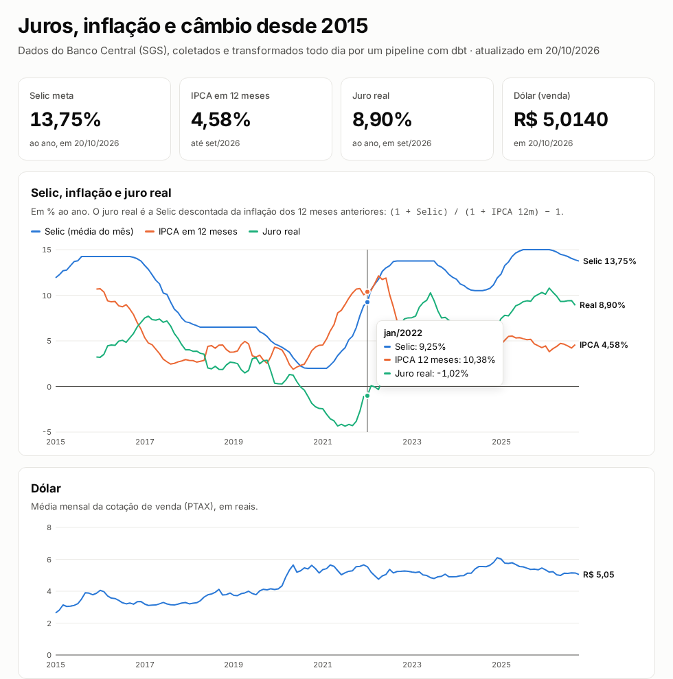

# Pipeline BCB — Indicadores macroeconômicos

Pipeline ELT que coleta **Selic, IPCA e dólar** da API pública do Banco Central (SGS), carrega em PostgreSQL e transforma com dbt em uma tabela mensal com **juro real** e **inflação acumulada em 12 meses**. Roda todo dia útil no GitHub Actions e publica uma página com os gráficos.

**📈 Página:** https://luissfellipe.github.io/pipeline-bcb/ · **📚 Documentação do dbt:** https://luissfellipe.github.io/pipeline-bcb/dbt/



**Pergunta de negócio:** como juros, inflação e câmbio se comportaram desde 2015, e quando o juro real esteve alto ou negativo?

## O que os dados mostram

- **O juro real ficou negativo em 21 meses entre jul/2020 e abr/2022.** A Selic ficou em 2% de set/2020 a fev/2021, e o IPCA em 12 meses chegou a 12,13% em abr/2022. O ponto mais baixo foi −4,35% ao ano, em jul/2021.
- **Depois, o movimento inverteu.** A Selic chegou a 15% em jul/2025, o maior valor desde 2015, e o juro real chegou a 10,78% ao ano em fev/2026, o maior da série.
- **O dólar teve a maior média mensal em dez/2024,** com R$ 6,10.

## Arquitetura

```
API SGS/BCB ──► ingest_bcb.py ──► Postgres (raw) ──► dbt (staging ──► marts) ──► export_site.py ──► página estática
                (incremental,                         views         tabelas         JSON              (GitHub Pages)
                 upsert)                              testadas      analíticas
                       GitHub Actions: todo dia útil, do zero, com testes antes de publicar
```

| Camada | Objeto | Descrição |
|---|---|---|
| raw | `raw.sgs_series` | Dados como vieram da API, chave `(codigo_serie, data)` |
| staging | `staging.stg_bcb__series` | Tipagem e testes de qualidade |
| seeds | `seeds.ipca_anual_ibge` | IPCA anual divulgado pelo IBGE, usado como gabarito |
| marts | `marts.fct_indicadores_mensais` | Um registro por mês: Selic média, IPCA, IPCA 12m, juro real e dólar |

## Decisões técnicas

- **Carga incremental:** o script consulta a última data carregada de cada série e busca só o que falta. O `ON CONFLICT` deixa a execução idempotente.
- **Paginação por janelas:** a API do SGS limita séries diárias a 10 anos por consulta, então a carga inicial é feita em janelas de 5 anos.
- **IPCA 12m composto, não somado:** `exp(sum(ln(1 + taxa)))` sobre uma janela de 12 meses. Meses com a janela incompleta ficam nulos.
- **Juro real pela equação de Fisher:** `(1 + Selic) / (1 + IPCA 12m) − 1`.
- **A conta é conferida contra o número oficial.** O IPCA 12 meses de cada dezembro tem de bater com o IPCA anual que o IBGE divulga (`seeds/ipca_anual_ibge.csv`), com tolerância de 0,02 ponto. O BCB publica o IPCA mensal com duas casas, e compor doze valores arredondados dá até 0,01 de diferença: em 2022, o calculado é 5,78 e o oficial, 5,79. Para conferir que o teste pega erro, o gabarito de 2022 foi trocado para 5,85, e o teste falhou.
- **Testes que protegem a janela de 12 meses:** um mês faltando no meio da série faria a janela cobrir 13 meses sem dar erro nenhum. Um teste exige a série mensal contínua.
- **Aviso de dado parado:** se a Selic ou o dólar ficarem mais de 7 dias sem dado novo, ou o IPCA mais de 75, o `dbt build` avisa.
- **Cards mostram o último dado, não a média do mês:** a Selic do card é a meta vigente no último dia, e o gráfico usa a média mensal.

## Como rodar

Requisitos: Docker e [uv](https://docs.astral.sh/uv/).

```bash
cp .env.example .env
uv sync
make pipeline        # sobe o Postgres, ingere, roda dbt build (modelos + 19 testes) e exporta a página
make site            # serve a página em http://localhost:8002
```

Consultar o resultado:

```bash
docker compose exec postgres psql -U bcb -c "select * from marts.fct_indicadores_mensais order by mes desc limit 12"
```

## Agendamento e dashboard

Aqui o agendamento é o GitHub Actions, que roda o pipeline do zero e publica a página. O [painel-economico](https://github.com/LuissFellipe/painel-economico) mostra o mesmo pipeline rodando como serviço, com agendador próprio e dashboard em Streamlit num único `docker compose`.

## Fonte

[Banco Central, Sistema Gerenciador de Séries Temporais](https://www3.bcb.gov.br/sgspub/): séries 432 (Selic meta), 433 (IPCA) e 1 (dólar comercial, venda). IPCA anual: [IBGE](https://www.ibge.gov.br/explica/inflacao.php).
